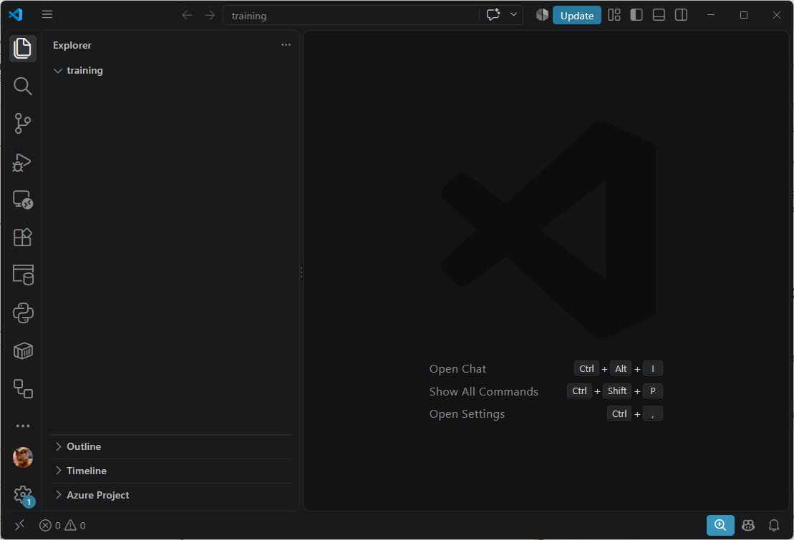
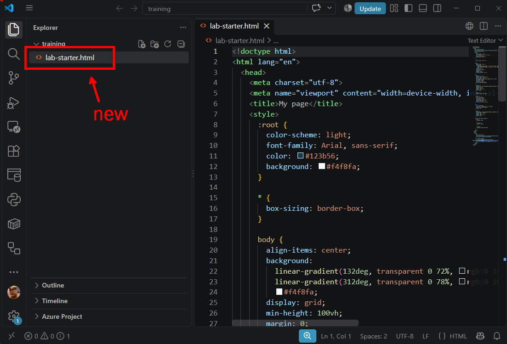
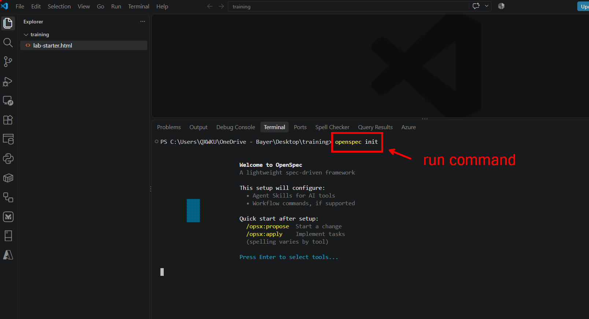
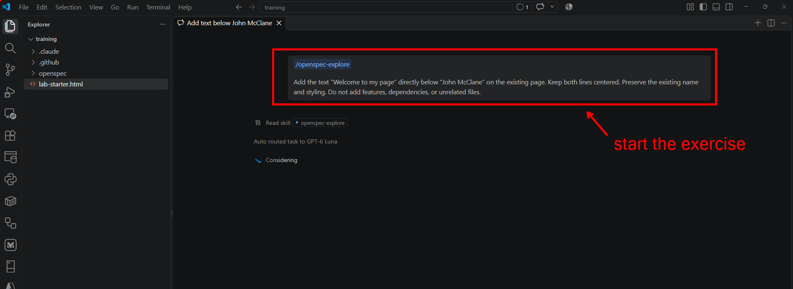

# Lab 1: Add a welcome message

**Time:** 35 minutes  
**Format:** Work individually

## Goal

Practice the OpenSpec change workflow on a deliberately small, predictable request. The focus is on reviewing the proposed change and checking the implementation, not on asking the AI to solve a complex problem.

## Starting point

Start with a clean OpenSpec project. Complete the [setup preflight](../README.md#setup-preflight) before the session so installation and editor setup do not consume lab time.

## Instructions

1. Create a new, empty folder on your laptop for the exercise.
2. Open that folder in Visual Studio Code. Do not use a project containing private or production data.
   
   
   
3. Copy the distributed [`lab-starter.html`](./lab-starter.html) file into the project root. The page displays **John McClane** in the center.
   
   

4. Open the integrated terminal in the new project folder and initialize OpenSpec:
   
   > openspec init

   Example view:

   

   Complete the interactive setup for the agent integration you are using. Confirm that initialization finishes and the expected OpenSpec files appear before continuing. If it fails, ask the trainer for help rather than proceeding with a partially initialized project.

5. Create a change proposal for this request:

   > /openspec-explore
   >
   > Add the text “Welcome to my page” directly below “John McClane” on the existing page. Keep both lines centered. Preserve the existing name and styling. Do not add features, dependencies, or unrelated files.

   Example view:

   

6. Review the proposal before applying it. Check that the requested text and layout are clear, the scope has not grown, and the tasks include a way to verify the result.
7. Apply the change.
8. Inspect the diff and open the page. Confirm the result matches the request.

## Definition of done

- “John McClane” is still present.
- “Welcome to my page” appears directly below the name.
- Both lines are centered.
- No unrelated changes or dependencies were added.

## Useful OpenSpec commands

| Command         | Purpose                                              |
| --------------- | ---------------------------------------------------- |
| `/opsx-explore` | Explore an idea and clarify requirements.            |
| `/opsx-propose` | Create a change proposal and its planning artifacts. |
| `/opsx-update`  | Revise an existing change's planning artifacts.      |
| `/opsx-apply`   | Implement the tasks in a change.                     |
| `/opsx-archive` | Archive a completed change.                          |

## Self-Reflection

Reflect on the following:

> Was the proposal useful for this change, or would you normally just make the edit? What is the smallest change where you would choose to use OpenSpec?

This is intentionally a tiny exercise for rehearsing the workflow. In day-to-day work, using OpenSpec for every small edit can add unnecessary overhead.
